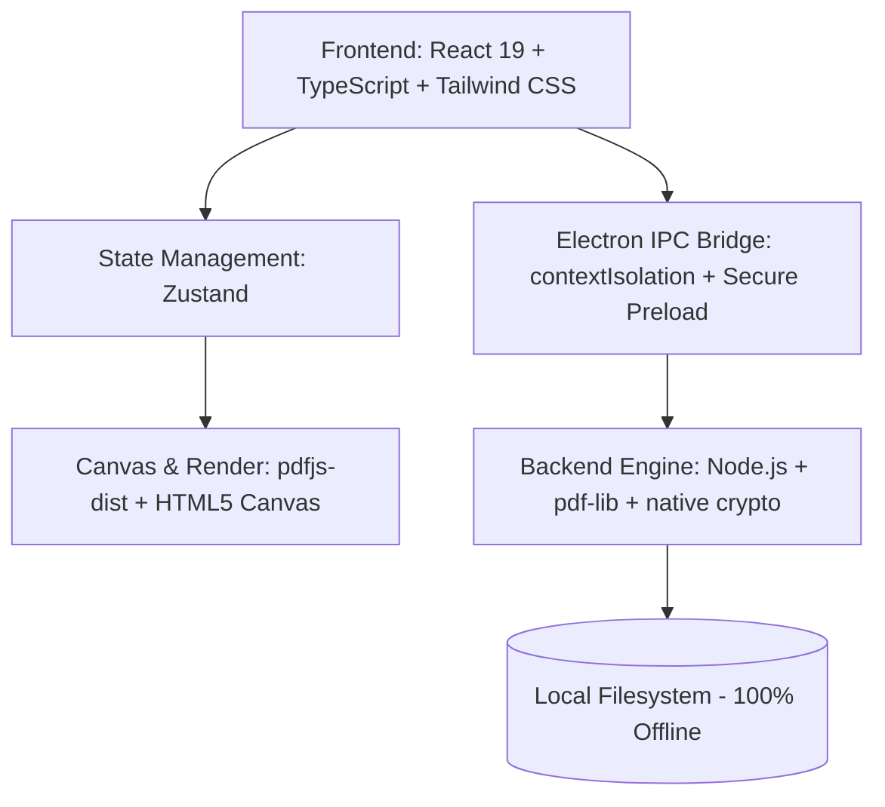

# Product Requirement Document (PRD) — EditIn

## 1. Ringkasan Eksekutif & Identitas Produk
* **Nama Produk**: EditIn
* **Brand / Publisher**: Ngoods (bagian dari ekosistem *Ngoods Suite* bersama **ConvertIn**)
* **Tagline**: *"Fast, Private & Offline PDF Editor and Document Studio"*
* **Platform Target**: Windows 10 & Windows 11 (64-bit Desktop)
* **Distribusi Utama**:
  * Microsoft Store (MSIX / AppX Resmi via Microsoft Partner Center)
  * GitHub Releases (Installer Standar & Portable)
* **Status**: Tahap Perencanaan & Desain Arsitektur (Siap dieksekusi)

---

## 2. Design System & Konsistensi UI dengan ConvertIn
Untuk mempertahankan identitas brand *Ngoods Suite*, **EditIn** mengadopsi 100% DNA desain dari **ConvertIn**:

| Elemen UI | Implementasi di ConvertIn | Implementasi di EditIn |
| :--- | :--- | :--- |
| **Titlebar** | Frameless, badge `CONVERTIN // CONVERTER`, drag region, window controls (min, max, close) | Frameless, badge `EDITIN // DOC STUDIO`, drag region, window controls (min, max, close) |
| **Sidebar Navigasi** | Collapsible (`w-60` expand / `w-16` collapse) dengan transisi halus | Format yang sama persis: tombol collapse, icon vertikal, switch Dark/Light mode di bawah |
| **Dark Theme** | `#0C0D12` (Obsidian), card `#13151D`, border `border-white/5` | **Sama persis** (`#0C0D12` & `#13151D`), memberi kesan satu keluarga produk |
| **Light Theme** | `#EEF1F6` (Zinc/Slate), card `#FFFFFF`, shadow lembut | **Sama persis** (`#EEF1F6` & `#FFFFFF`) |
| **Aksen Warna (Brand)**| Emerald Neon Green (`#10B981`) & Cyan | **Indigo / Electric Violet (`#6366F1` / `#8B5CF6`)** untuk kesan presisi studio dokumen |
| **Komponen UI** | Glassmorphism card, rounded-2xl, dashed dropzone dengan hover glow | Diadopsi langsung untuk thumbnail grid halaman PDF & dropzone file |
| **Deck Bawah** | Bottom bar status antrean & tombol besar aksi konversi | Bottom bar ringkasan halaman & tombol besar *"Export / Apply Changes"* |

---

## 3. Latar Belakang & Masalah (Problem Statement)
1. **Model Langganan Mahal**: Software standar industri seperti Adobe Acrobat mewajibkan langganan bulanan mahal ($19–$29/bulan) hanya untuk merge, rotate, atau tanda tangan dokumen.
2. **Kekhawatiran Privasi (Data Leak Risk)**: Web tool gratis (iLovePDF, SmallPDF) mewajibkan upload dokumen sensitif (KTP, kontrak, slip gaji) ke cloud pihak ketiga.
3. **Limitasi & Iklan**: Web tool membatasi ukuran file, jumlah dokumen harian, dan dipenuhi iklan pelacak.
4. **Kebutuhan Harian**: Merge berkas lamaran, tanda tangan digital surat pernyataan, dan kompres PDF syarat CPNS/beasiswa (< 2MB) terjadi berulang kali.

---

## 4. Ruang Lingkup Fitur (MVP Version 1.0)

### 4.1. Visual Page Manager (Tile Grid Canvas)
* **Interactive Thumbnail Grid**: Membuka dokumen PDF dan merender setiap halaman menjadi kartu visual.
* **Drag-and-Drop Reorder**: Geser thumbnail kartu untuk menyusun ulang urutan halaman.
* **Page Delete**: Hapus halaman yang tidak diinginkan dengan 1 klik (individual atau multi-select).
* **Page Rotate**: Putar halaman 90° clockwise, counter-clockwise, atau 180° untuk membetulkan hasil scan terbalik.
* **Insert Pages**: Sisipkan halaman dari file PDF lain ke posisi tertentu.

### 4.2. Smart Merge & Split Studio
* **Multi-file PDF Merger**: Menggabungkan 2 atau lebih file PDF menjadi 1 berkas dengan preview urutan.
* **Split Modes**:
  * *Extract Custom Pages*: Ekstrak rentang halaman tertentu (misal: halaman `1-3, 5, 8-10`).
  * *Split Every N Pages*: Pecah dokumen menjadi beberapa file kecil setiap N halaman.

### 4.3. Offline Digital Signature & Stamp
* **Draw & Save Signature**: Kanvas tanda tangan halus menggunakan mouse/touchpad/stylus dengan pilihan warna (hitam/biru).
* **Image Signature Import**: Upload foto tanda tangan transparan (PNG).
* **Stamp Presets**: Pilihan cap instan satu klik (*"APPROVED"*, *"LUNAS"*, *"CONFIDENTIAL"*, *"DRAFT"*).
* **Placement & Resize**: Drag-and-drop tanda tangan / stempel ke posisi yang tepat pada halaman dengan handle resize proporsional.

### 4.4. Local PDF Slim (Compressor)
* **Preset Kompresi**:
  * *Web & Email Quality* (150 DPI, optimasi font).
  * *Target Size CPNS/Portal* (Target file < 2 MB / < 1 MB).
  * *Lossless Cleaning* (Hapus metadata tanpa menurunkan kualitas gambar).

### 4.5. Security & Protection
* **Encrypt with Password**: Pasang sandi pembuka (AES-128 / AES-256) agar dokumen aman.
* **Remove Password / Decrypt**: Hapus proteksi sandi dokumen jika memiliki akses yang sah.

---

## 5. Arsitektur Teknis & Tech Stack

* **Frontend**: React 19, TypeScript, Tailwind CSS, Lucide React Icons.
* **Desktop Wrapper**: Electron 34+ (dioptimalkan untuk Windows Desktop Bridge).
* **Core PDF Engine**:
  * `pdf-lib`: Manipulasi struktur halaman (merge, split, rotate, embed image, draw text, encrypt).
  * `pdfjs-dist`: Render visual thumbnail halaman PDF berkecepatan tinggi ke HTML5 Canvas.
* **Perbedaan Utama dari ConvertIn**: EditIn **TIDAK** membutuhkan binary FFmpeg (200MB+), sehingga ukuran paket installer menjadi **super ramping (hanya ~45 MB)**.

---

## 6. Integrasi Microsoft Store & Identitas Publisher

* **Publisher Name**: `Ngoods`
* **Publisher DN**: `CN=A92523C4-5EF5-4F58-85A8-408E3D78A880` (menggunakan akun developer Microsoft Partner Center yang sama dengan ConvertIn).
* **Package Identity Target**: `Ngoods.EditIn`
* **Packaging Target**: MSIX / AppX dengan kapabilitas `runFullTrust` untuk manipulasi file lokal.
* **CI/CD Pipeline**: GitHub Actions otomatis build & compile `.msix` / `.appx` saat tag rilis dibuat (`v1.0.0`).

---

## 7. Roadmap Pelaksanaan Proyek

| Fase | Target Kerja | Output |
| :--- | :--- | :--- |
| **Fase 1: Inisialisasi Proyek** | Setup repo `editin`, scaffold Electron + React + Tailwind + blueprint packaging ConvertIn | Kerangka aplikasi siap jalan dengan window modern |
| **Fase 2: Core PDF Canvas** | Integrasi `pdfjs-dist` & visual page thumbnail grid (Drag, reorder, delete, rotate) | Pengguna bisa visualisasi dan menata halaman PDF |
| **Fase 3: Merge, Split & Compress** | Implementasi `pdf-lib` untuk proses gabung, pisah, dan kompresi file | Fitur esensial dokumen bekerja 100% offline |
| **Fase 4: Signature & Security** | Kanvas tanda tangan, stamp placement, password encryption | Fitur penandatanganan dan proteksi dokumen |
| **Fase 5: Packaging & Store Release** | Icon & store assets (720x1080 & 1080x1080), workflow GitHub Actions, submit ke Partner Center | EditIn resmi rilis di Microsoft Store & GitHub |

---

## 8. Panduan Penggunaan Dokumen Ini untuk Sesi Baru
Saat Anda siap memulai proyek ini di chat baru, cukup katakan:
> *"Saya ingin mulai kerjakan project **EditIn** sesuai PRD yang sudah dibuat sebelumnya."*
Dokumen ini langsung menjadi panduan teknis lengkap dari awal hingga rilis!
