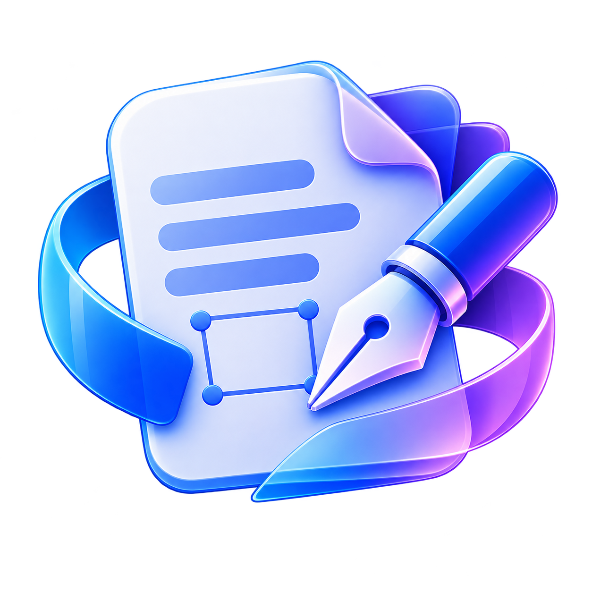

  
  <h1>EditIn</h1>
  
<strong>Fast, Private &amp; 100% Offline PDF Editor and Document Studio</strong>

  

    
    
    
  

---

**EditIn** adalah aplikasi desktop untuk mengedit, mengatur, menggabungkan, mengompres, dan mengamankan dokumen PDF **100% secara offline** langsung dari perangkat Anda. Tanpa upload ke server, tanpa batasan kuota harian, dan tetap cepat untuk dokumen besar.

---

## ✨ Kenapa Memilih EditIn?

- 🔒 **100% Offline & Privat** — Seluruh pemrosesan PDF berjalan lokal di komputer Anda. Dokumen sensitif tidak pernah dikirim ke server mana pun.
- ⚡ **Satu Aplikasi untuk Semua Kebutuhan PDF** — Tidak perlu membuka banyak situs atau software terpisah.
- 🎨 **Antarmuka Bersih & Nyaman** — Mendukung **Dark Mode & Light Mode** serta pilihan bahasa **Indonesia & English**.

---

## 🛠️ Fitur Utama

| Fitur | Kegunaan |
| :--- | :--- |
| **Editor PDF** | Edit teks langsung di halaman PDF, tambah teks baru, highlight, dan anotasi. |
| **Kelola Halaman** | Putar (*rotate*), hapus, dan atur ulang urutan halaman dengan tampilan grid. |
| **Gabung PDF (Merge)** | Satukan beberapa file PDF menjadi satu dokumen rapi. |
| **Pisah PDF (Split)** | Ekstrak halaman tertentu (misal `1-3, 5`) atau pecah per beberapa halaman. |
| **Tanda Tangan & Stempel** | Gambar tanda tangan digital langsung di aplikasi atau tempel stempel resmi. |
| **Kompres PDF** | Perkecil ukuran file PDF dengan preset *Extreme*, *Balanced*, atau *High*. |
| **Proteksi Password** | Kunci dokumen PDF penting Anda dengan enkripsi password. |

---

## 🚀 Cara Menggunakan

1. **Buka File PDF** — Klik **Buka PDF** di halaman utama atau tarik (*drag & drop*) file langsung ke dalam aplikasi.
2. **Pilih Studio** — Pilih alat yang Anda butuhkan dari sidebar di sebelah kiri.
3. **Simpan Hasilnya** — Klik tombol **Simpan / Export** di bagian bawah untuk menyimpan PDF baru ke folder pilihan Anda.

---

## 🔐 Privasi & Keamanan

EditIn tidak mengumpulkan data pengguna, tidak memiliki analitik/tracker, dan tidak memerlukan koneksi internet untuk bekerja. Detail lengkap tersedia di [PRIVACY.md](./PRIVACY.md).

---

## ☕ Dukung Developer

Dikembangkan oleh **Ngoods Studio** (`@naufalt`).  
Jika EditIn membantu pekerjaan Anda, Anda bisa mendukung pengembangan aplikasi ini melalui menu **Pengaturan → Traktir Matcha (QRIS Ngoods)** di dalam aplikasi.

---

  Made with ❤️ by <a href="https://github.com/naufalt">Ngoods Studio</a>

